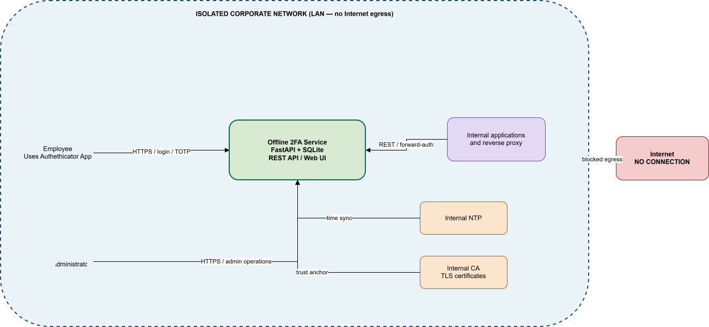
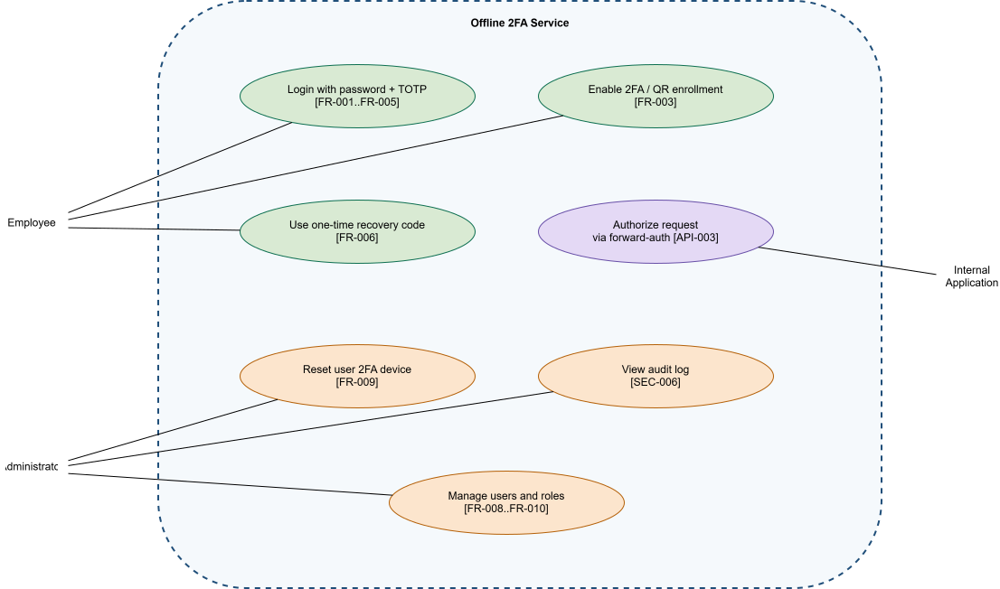
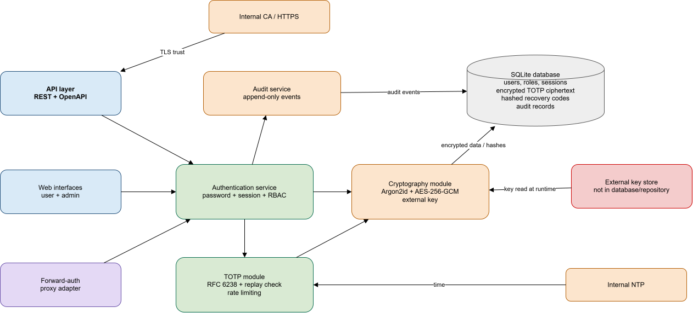

# System Architecture

## Purpose

This architecture describes an MVP local two-factor authentication service for an isolated corporate network. The service runs inside the LAN without external Internet access and uses internal NTP and CA services. The primary second factor is TOTP; integration is provided through a REST API and forward-auth.

The editable source for all three diagrams is in [offline-2fa-architecture.drawio](../../diagrams/src/offline-2fa-architecture.drawio). The file contains three pages and opens in diagrams.net/draw.io.

## Context Diagram

The context diagram shows the employee, administrator, internal applications/reverse proxy, the service, internal NTP, and the internal CA. The red boundary and dashed connection explicitly show that there is no Internet egress.

## Use-Case Diagram

The diagram shows the actors and the main MVP scenarios. Identifiers in parentheses refer to the requirements in [requirements.md](../requirements/requirements.md): sign-in — FR-001–FR-005, 2FA enrollment — FR-003, recovery — FR-006, forward-auth — API-003, device reset — FR-009, audit — SEC-006, and user and role management — FR-008–FR-010.

## Component Diagram Draft

The service is divided into an API/Web/forward-auth layer, authentication service, TOTP module, cryptography module, audit service, and SQLite. TOTP secrets are stored only as AES-256-GCM ciphertext, recovery codes as hashes, and the encryption key is kept in an external key store and never enters the database or Git. Time comes from internal NTP, and TLS trusts the internal CA.

## Requirements, Components, and Scenario Traceability

| Requirements | Components | Scenarios |
|---|---|---|
| FR-001, FR-002, FR-007 | API layer, Authentication service, Cryptography | Sign-in, password change, session revocation |
| FR-003, FR-004, FR-005 | TOTP module, Cryptography, Internal NTP, SQLite | QR enrollment, TOTP verification, replay protection |
| FR-006 | TOTP module, Cryptography, SQLite | Recovery-code use |
| FR-008, FR-009, FR-010 | Web interfaces, API layer, Authentication service, Audit service | User management, RBAC, device reset |
| API-001, API-002 | API layer, Authentication service | REST API and request authorization |
| API-003, API-004 | Forward-auth, Authentication service | Reverse-proxy request verification |
| SEC-001, SEC-010 | API layer, Web interfaces, Internal CA | HTTPS and browser/API request protection |
| SEC-002, SEC-003, SEC-007 | Cryptography, SQLite, External key store | Secret and log protection |
| SEC-004, SEC-006, SEC-008 | Authentication service, TOTP module, Audit service | Lockout, audit, RBAC |
| NFR-001–NFR-006 | All runtime components, Internal NTP/CA | Offline deployment and backup |

## Architectural Constraints and Boundaries

- Internet, SMS, push, e-mail, and cloud MFA providers are not used.
- WebAuthn, OIDC, LDAP/AD, RADIUS, and SIEM export remain extensions.
- SQLite is selected for the single-node MVP; PostgreSQL may be added for multi-instance deployment.
